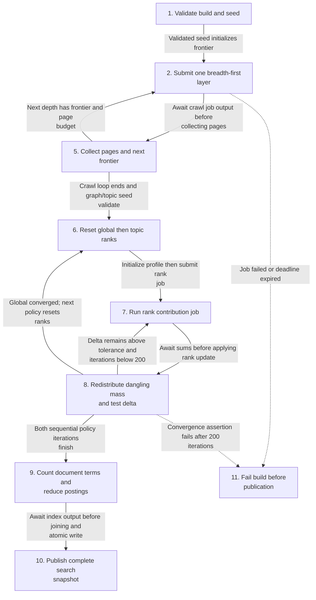
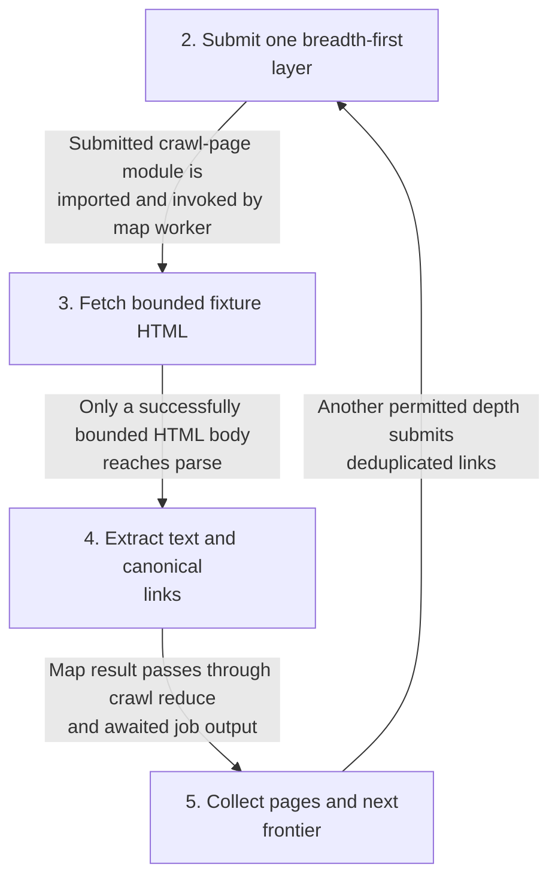
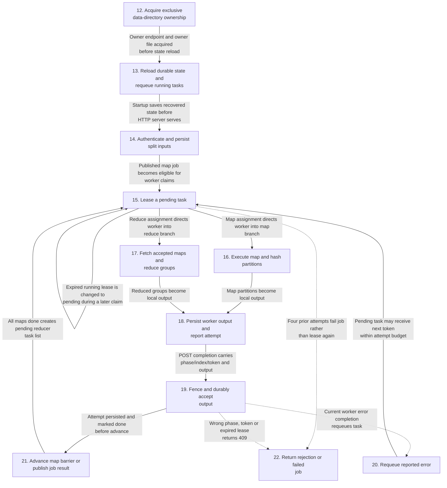
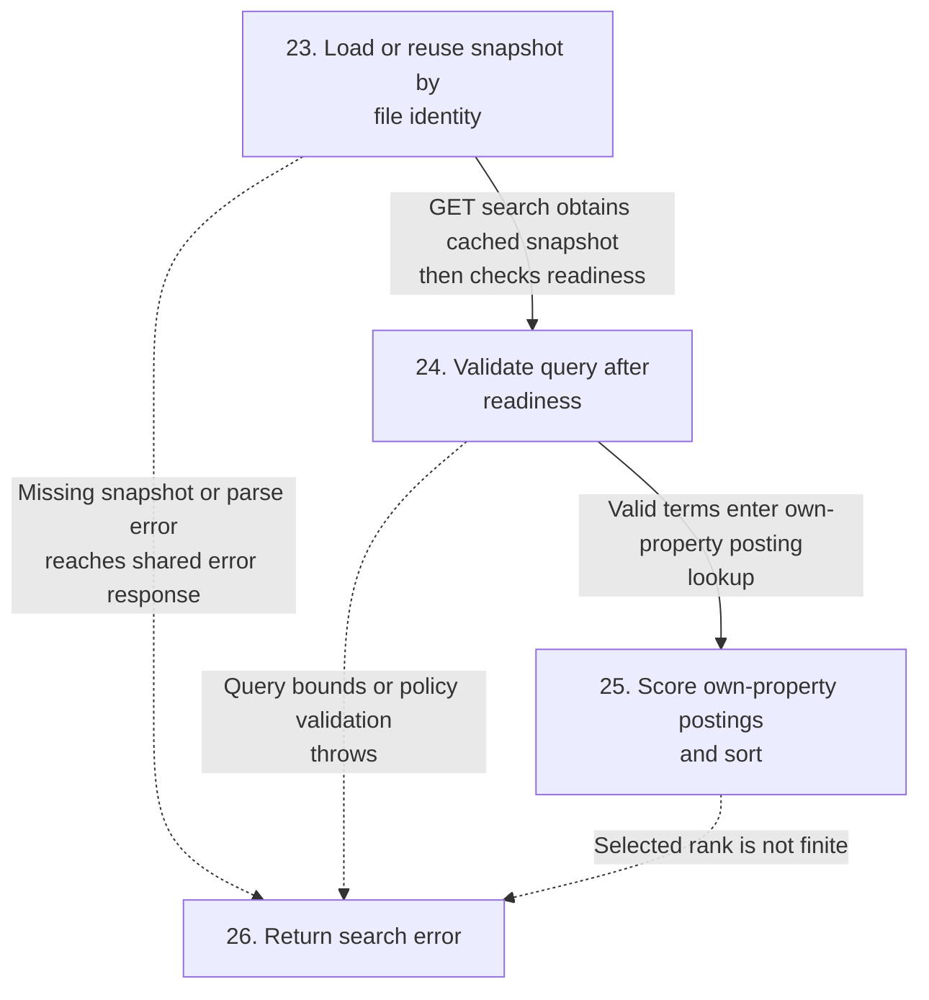
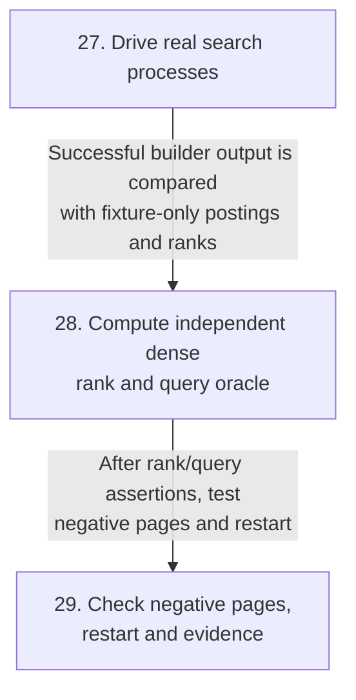
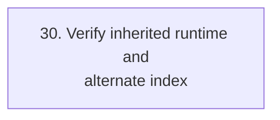
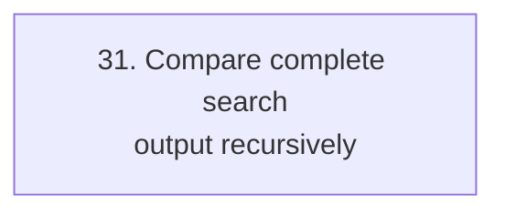
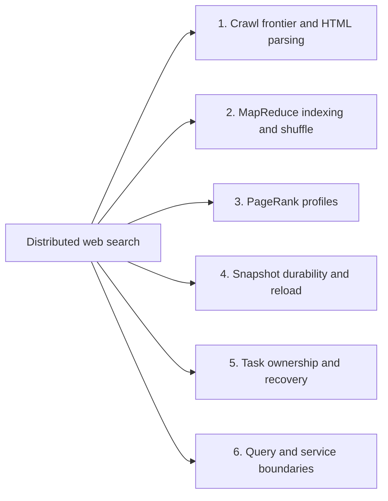
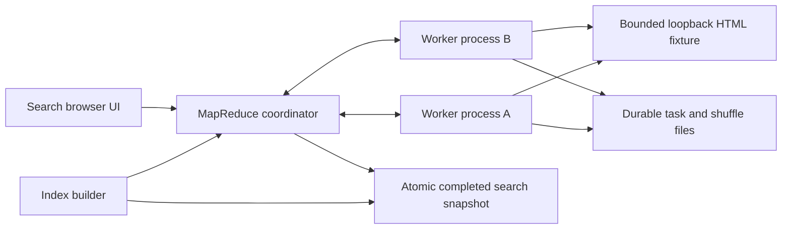

# Distributed web search

## Architecture and execution guide

<!-- execution-flow:start -->
### Execution flow

Start with the primary path, then expand a detailed workflow. Select a numbered node to see its operation, implementation techniques, and source. Solid arrows show the named control, data, or lifecycle handoff; dotted arrows show error paths. Separate entry points are named in each workflow.

<a id="review-walkthrough"></a>

#### Walk through one concrete example

Build a search snapshot from the bounded local fixture site, then query that snapshot through the separate search API.

**Trace.** [Validate build and seed](#flow-step-build-config) → [Collect pages and next frontier](#flow-step-collect-pages) → [Reset global then topic ranks](#flow-step-rank-profile) → [Redistribute dangling mass and test delta](#flow-step-rank-update) → [Count document terms and reduce postings](#flow-step-index-postings) → [Publish complete search snapshot](#flow-step-publish-snapshot).

**Result and boundary.** The builder publishes complete pages, link ranks and inverted postings as one atomic snapshot. Global ranking precedes topic ranking; a failed build does not publish a partial snapshot.

In the separate search API, submit a bounded query against the published snapshot. This is another entry point, not an automatic call from the builder.

**Follow-up trace.** [Load or reuse snapshot by file identity](#flow-step-load-snapshot) → [Validate query after readiness](#flow-step-query-validate) → [Score own-property postings and sort](#flow-step-query-score).

The API loads or reuses the snapshot by file identity, validates the query, scores matching postings and returns sorted results.

<details>
<summary>Implementation decisions to explain</summary>

**Why crawl one frontier depth at a time and normalize URLs before adding them?** Layered BFS makes depth and page limits explicit, while normalized deduplication prevents fragments or alternate URL spellings from multiplying work. The boundary is same-origin bounded crawling, not an unrestricted web crawler.

[Bounded same-origin breadth-first crawl](#technique-same-origin-bounded-bfs) · [URL normalization and frontier deduplication](#technique-url-normalization-deduplication).

</details>

#### Primary execution flow

The builder CLI waits for each distributed job. The final file is consumed by independently arriving search requests; query arrival is not triggered by publication.



**Detailed workflows.** [Crawl worker and layered frontier](#flow-workflow-crawl) · [Durable MapReduce scheduling and recovery](#flow-workflow-runtime) · [Snapshot reload and query serving](#flow-workflow-search) · [Independent search verification](#flow-workflow-verification) · [Separate retained-runtime verification](#flow-workflow-runtime-verification) · [Reusable output comparison](#flow-workflow-output-oracle).

<a id="flow-workflow-crawl"></a>

<details>
<summary>Crawl worker and layered frontier</summary>

Each crawl job uses the runtime workflow below; page parsing happens inside map execution.



</details>

<a id="flow-workflow-runtime"></a>

<details>
<summary>Durable MapReduce scheduling and recovery</summary>

Coordinator and workers are separate processes. Claim polling drives lease expiry; no independent lease timer is present.



</details>

<a id="flow-workflow-search"></a>

<details>
<summary>Snapshot reload and query serving</summary>

Unauthenticated loopback GET requests independently enter searchSnapshot; status uses the same loader without query scoring.



</details>

<a id="flow-workflow-verification"></a>

<details>
<summary>Independent search verification</summary>

Verification-only CLI drives real local processes, then retains evidence; it is not a production runtime stage.



</details>

<a id="flow-workflow-runtime-verification"></a>

<details>
<summary>Separate retained-runtime verification</summary>

Independent CLI also executes the older inverted-index document-membership job; it is not the active index-document builder job.



</details>

<a id="flow-workflow-output-oracle"></a>

<details>
<summary>Reusable output comparison</summary>

Independent exported helper, with no invocation from verify-search.



</details>

#### Steps, techniques, and source

These source traces cover the active scope below. They explain implementation behavior; benchmark results and their limits remain in the measurement sections.

<a id="flow-step-build-config"></a>

##### 1. Validate build and seed

**Component.** build-index. Require loopback API and owned fixture origin, validate bounded settings and normalize the same-origin seed. Establish per-job and whole-build deadlines.

**Techniques at this step.** [Bounded same-origin breadth-first crawl](#technique-same-origin-bounded-bfs) · [URL normalization and frontier deduplication](#technique-url-normalization-deduplication).

**Source.** [`tools/build-index.mjs:9`](https://github.com/STEVVVU/distributed-web-search/blob/main/tools/build-index.mjs#L9). [Back to execution flow](#execution-flow).

<a id="flow-step-crawl-frontier"></a>

##### 2. Submit one breadth-first layer

**Component.** build-index. Deduplicate unseen frontier URLs and truncate to the remaining page budget. Await one crawl-page job before collecting the next depth.

**Techniques at this step.** [Bounded same-origin breadth-first crawl](#technique-same-origin-bounded-bfs) · [URL normalization and frontier deduplication](#technique-url-normalization-deduplication).

**Source.** [`tools/build-index.mjs:31`](https://github.com/STEVVVU/distributed-web-search/blob/main/tools/build-index.mjs#L31). [Back to execution flow](#execution-flow).

<a id="flow-step-crawl-fetch"></a>

##### 3. Fetch bounded fixture HTML

**Component.** crawl-page.map. Reject URLs outside the fixture or URL bounds. Fetch without redirects with a two-second timeout, require successful HTML, and cancel the reader on a body error or size beyond 256 KiB.

**Techniques at this step.** [Bounded same-origin breadth-first crawl](#technique-same-origin-bounded-bfs) · [Loopback authentication and request bounds](#technique-loopback-auth-and-resource-bounds).

**Source.** [`jobs/crawl-page.mjs:13`](https://github.com/STEVVVU/distributed-web-search/blob/main/jobs/crawl-page.mjs#L13). [Back to execution flow](#execution-flow).

<a id="flow-step-crawl-parse"></a>

##### 4. Extract text and canonical links

**Component.** crawl-page.map. parse5 repairs and parses HTML. Extract title/body text and same-origin links, drop fragments, discard invalid links, and return unique sorted links.

**Techniques at this step.** [parse5 tree text and link extraction](#technique-parse5-tree-extraction) · [URL normalization and frontier deduplication](#technique-url-normalization-deduplication).

**Source.** [`jobs/crawl-page.mjs:29`](https://github.com/STEVVVU/distributed-web-search/blob/main/jobs/crawl-page.mjs#L29). [Back to execution flow](#execution-flow).

<a id="flow-step-collect-pages"></a>

##### 5. Collect pages and next frontier

**Component.** build-index. Store returned pages and enqueue their links while another depth is allowed. Stop at an empty batch or configured depth, then require pages and a crawled /ranking topic seed.

**Techniques at this step.** [Bounded same-origin breadth-first crawl](#technique-same-origin-bounded-bfs).

**Source.** [`tools/build-index.mjs:36`](https://github.com/STEVVVU/distributed-web-search/blob/main/tools/build-index.mjs#L36). [Back to execution flow](#execution-flow).

<a id="flow-step-rank-profile"></a>

##### 6. Reset global then topic ranks

**Component.** build-index. Restrict adjacency to crawled pages. Run policies sequentially, resetting ranks uniformly and selecting uniform or /ranking-only teleport.

**Techniques at this step.** [Sequential global and topic PageRank convergence](#technique-iterative-global-topic-convergence) · [Teleport and dangling-mass redistribution](#technique-teleport-dangling-page-rank).

**Source.** [`tools/build-index.mjs:39`](https://github.com/STEVVVU/distributed-web-search/blob/main/tools/build-index.mjs#L39). [Back to execution flow](#execution-flow).

<a id="flow-step-rank-contributions"></a>

##### 7. Run rank contribution job

**Component.** rank-contribution. Submit the current graph through MapReduce. Each linked node emits rank divided by outdegree; reducers sum incoming contributions, while dangling nodes emit no pairs.

**Techniques at this step.** [Sequential global and topic PageRank convergence](#technique-iterative-global-topic-convergence).

**Source.** [`jobs/rank-contribution.mjs:1`](https://github.com/STEVVVU/distributed-web-search/blob/main/jobs/rank-contribution.mjs#L1). [Back to execution flow](#execution-flow).

<a id="flow-step-rank-update"></a>

##### 8. Redistribute dangling mass and test delta

**Component.** build-index. Compute dangling mass before submission and update ranks with damping 0.85 and profile-specific teleport. Continue until L1 delta is at most 1e-10, or fail after 200 iterations.

**Techniques at this step.** [Teleport and dangling-mass redistribution](#technique-teleport-dangling-page-rank) · [Sequential global and topic PageRank convergence](#technique-iterative-global-topic-convergence).

**Source.** [`tools/build-index.mjs:47`](https://github.com/STEVVVU/distributed-web-search/blob/main/tools/build-index.mjs#L47). [Back to execution flow](#execution-flow).

<a id="flow-step-index-postings"></a>

##### 9. Count document terms and reduce postings

**Component.** index-document. After both rank policies finish, tokenize title and text into Unicode letter/number terms and count frequency. Reduce by term, deduplicate URLs and sort postings by URL.

**Techniques at this step.** [Term-frequency inverted indexing](#technique-term-frequency-inverted-index).

**Source.** [`jobs/index-document.mjs:1`](https://github.com/STEVVVU/distributed-web-search/blob/main/jobs/index-document.mjs#L1). [Back to execution flow](#execution-flow).

<a id="flow-step-publish-snapshot"></a>

##### 10. Publish complete search snapshot

**Component.** build-index / common.atomic. Join pages, postings and both rank profiles, then atomically write search-snapshot.json using an exclusive temporary file, fsync and rename. Earlier build errors never reach this write.

**Techniques at this step.** [Atomic complete-snapshot publication](#technique-atomic-complete-snapshot).

**Source.** [`tools/build-index.mjs:60`](https://github.com/STEVVVU/distributed-web-search/blob/main/tools/build-index.mjs#L60). [Back to execution flow](#execution-flow).

<a id="flow-step-build-failed"></a>

##### 11. Fail build before publication

**Component.** build-index.submit. A failed job or elapsed polling deadline throws; failed convergence and missing graph prerequisites also throw. The builder has no cancellation request for already submitted jobs.

This step records an explicit control boundary or terminal outcome rather than a separate ledger technique.

**Source.** [`tools/build-index.mjs:21`](https://github.com/STEVVVU/distributed-web-search/blob/main/tools/build-index.mjs#L21). [Back to execution flow](#execution-flow).

<a id="flow-step-owner"></a>

##### 12. Acquire exclusive data-directory ownership

**Component.** coordinator. Canonicalize the root and bind a platform-specific local owner endpoint before checking owner.json. Reject a live prior owner; only Windows and Linux are supported.

**Techniques at this step.** [Exclusive coordinator ownership](#technique-exclusive-coordinator-ownership).

**Source.** [`src/coordinator.mjs:14`](https://github.com/STEVVVU/distributed-web-search/blob/main/src/coordinator.mjs#L14). [Back to execution flow](#execution-flow).

<a id="flow-step-recover"></a>

##### 13. Reload durable state and requeue running tasks

**Component.** coordinator. Load state.json if present, mark persisted running tasks pending and save before serving. Persistence errors terminate the process rather than allowing further requests.

**Techniques at this step.** [Leased retry with accepted-attempt fencing](#technique-lease-retry-attempt-fencing) · [Durable task output before state acceptance](#technique-durable-attempt-publication).

**Source.** [`src/coordinator.mjs:47`](https://github.com/STEVVVU/distributed-web-search/blob/main/src/coordinator.mjs#L47). [Back to execution flow](#execution-flow).

<a id="flow-step-admit-job"></a>

##### 14. Authenticate and persist split inputs

**Component.** coordinator HTTP handler. Runtime routes require the configured bearer token. Validate trusted module, finite JSON pairs and partition counts, persist round-robin input splits before publishing the map job state.

**Techniques at this step.** [Loopback authentication and request bounds](#technique-loopback-auth-and-resource-bounds) · [Durable task output before state acceptance](#technique-durable-attempt-publication).

**Source.** [`src/coordinator.mjs:117`](https://github.com/STEVVVU/distributed-web-search/blob/main/src/coordinator.mjs#L117). [Back to execution flow](#execution-flow).

<a id="flow-step-claim"></a>

##### 15. Lease a pending task

**Component.** coordinator.claim. At claim time expire elapsed running leases, then assign a fresh token and deadline and persist before returning. The fifth attempted claim after four executions fails the job.

**Techniques at this step.** [Leased retry with accepted-attempt fencing](#technique-lease-retry-attempt-fencing).

**Source.** [`src/coordinator.mjs:67`](https://github.com/STEVVVU/distributed-web-search/blob/main/src/coordinator.mjs#L67). [Back to execution flow](#execution-flow).

<a id="flow-step-map-shuffle"></a>

##### 16. Execute map and hash partitions

**Component.** worker. Import the trusted job module, fetch and persist the input, invoke map and validate pairs. SHA256 first-word modulo reducer count selects each partition.

**Techniques at this step.** [Deterministic hash partitioning and shuffle](#technique-deterministic-hash-shuffle).

**Source.** [`src/worker.mjs:14`](https://github.com/STEVVVU/distributed-web-search/blob/main/src/worker.mjs#L14). [Back to execution flow](#execution-flow).

<a id="flow-step-reduce-shuffle"></a>

##### 17. Fetch accepted maps and reduce groups

**Component.** worker. After the map barrier, fetch each accepted map partition over HTTP and save it locally. Group by key, sort keys and invoke the job reducer.

**Techniques at this step.** [Deterministic hash partitioning and shuffle](#technique-deterministic-hash-shuffle).

**Source.** [`src/worker.mjs:22`](https://github.com/STEVVVU/distributed-web-search/blob/main/src/worker.mjs#L22). [Back to execution flow](#execution-flow).

<a id="flow-step-complete"></a>

##### 18. Persist worker output and report attempt

**Component.** worker. Atomically save local output before posting completion. Non-HTTP execution errors are reported to the coordinator as bounded error strings; other failures are logged before polling resumes.

**Techniques at this step.** [Durable task output before state acceptance](#technique-durable-attempt-publication).

**Source.** [`src/worker.mjs:31`](https://github.com/STEVVVU/distributed-web-search/blob/main/src/worker.mjs#L31). [Back to execution flow](#execution-flow).

<a id="flow-step-accept"></a>

##### 19. Fence and durably accept output

**Component.** coordinator completion route. Return duplicate success for the accepted token. Otherwise require matching live phase, running token and unexpired lease, validate output partitions or reduced keys, persist the attempt before marking it done, advancing and saving state.

**Techniques at this step.** [Leased retry with accepted-attempt fencing](#technique-lease-retry-attempt-fencing) · [Durable task output before state acceptance](#technique-durable-attempt-publication).

**Source.** [`src/coordinator.mjs:158`](https://github.com/STEVVVU/distributed-web-search/blob/main/src/coordinator.mjs#L158). [Back to execution flow](#execution-flow).

<a id="flow-step-retry"></a>

##### 20. Requeue reported error

**Component.** coordinator completion route. A valid current error completion sets the task pending and saves an error event. Retry assignment still consumes the shared four-attempt budget.

**Techniques at this step.** [Leased retry with accepted-attempt fencing](#technique-lease-retry-attempt-fencing).

**Source.** [`src/coordinator.mjs:161`](https://github.com/STEVVVU/distributed-web-search/blob/main/src/coordinator.mjs#L161). [Back to execution flow](#execution-flow).

<a id="flow-step-barrier"></a>

##### 21. Advance map barrier or publish job result

**Component.** coordinator.advance. All maps done replaces the active task list with reducers. All reducers done reads accepted attempt artifacts, sorts keys and persists the result before marking the job done.

**Techniques at this step.** [Durable task output before state acceptance](#technique-durable-attempt-publication).

**Source.** [`src/coordinator.mjs:57`](https://github.com/STEVVVU/distributed-web-search/blob/main/src/coordinator.mjs#L57). [Back to execution flow](#execution-flow).

<a id="flow-step-runtime-error"></a>

##### 22. Return rejection or failed job

**Component.** coordinator. Stale completions return 409 and invalid runtime requests return their validation status. Exhausted tasks mark the job failed; persistence failure exits the coordinator.

**Techniques at this step.** [Leased retry with accepted-attempt fencing](#technique-lease-retry-attempt-fencing) · [Loopback authentication and request bounds](#technique-loopback-auth-and-resource-bounds).

**Source.** [`src/coordinator.mjs:160`](https://github.com/STEVVVU/distributed-web-search/blob/main/src/coordinator.mjs#L160). [Back to execution flow](#execution-flow).

<a id="flow-step-load-snapshot"></a>

##### 23. Load or reuse snapshot by file identity

**Component.** coordinator.searchSnapshot. Stat dev, inode, size and nanosecond modification/change times. Reuse unchanged parsed data and first-URL document map; clear cache on removal or before reading a replacement, so corrupt reads remain visible.

**Techniques at this step.** [File-identity cached snapshot reload](#technique-file-identity-cache-reload).

**Source.** [`src/coordinator.mjs:37`](https://github.com/STEVVVU/distributed-web-search/blob/main/src/coordinator.mjs#L37). [Back to execution flow](#execution-flow).

<a id="flow-step-query-validate"></a>

##### 24. Validate query after readiness

**Component.** coordinator /api/search. Search loads the snapshot first and returns 503 if absent. Then enforce at most 512 characters, valid global/topic policy and at most 16 distinct Unicode terms.

**Techniques at this step.** [Query validation and stable result ordering](#technique-bounded-query-validation-stable-ranking).

**Source.** [`src/coordinator.mjs:93`](https://github.com/STEVVVU/distributed-web-search/blob/main/src/coordinator.mjs#L93). [Back to execution flow](#execution-flow).

<a id="flow-step-query-score"></a>

##### 25. Score own-property postings and sort

**Component.** coordinator /api/search. For each distinct term, use own-property lookup and sum tf times ln(1+N/df). Add selected finite rank, produce snippet, and sort descending score then URL before JSON response.

**Techniques at this step.** [Query validation and stable result ordering](#technique-bounded-query-validation-stable-ranking).

**Source.** [`src/coordinator.mjs:103`](https://github.com/STEVVVU/distributed-web-search/blob/main/src/coordinator.mjs#L103). [Back to execution flow](#execution-flow).

<a id="flow-step-query-error"></a>

##### 26. Return search error

**Component.** coordinator HTTP handler. Missing snapshot or unavailable rank returns 503; invalid query returns 400. Snapshot parsing errors reach the shared JSON error response as 500.

This step records an explicit control boundary or terminal outcome rather than a separate ledger technique.

**Source.** [`src/coordinator.mjs:181`](https://github.com/STEVVVU/distributed-web-search/blob/main/src/coordinator.mjs#L181). [Back to execution flow](#execution-flow).

<a id="flow-step-verify-fixture"></a>

##### 27. Drive real search processes

**Component.** verify-search. Verification starts owned fixture, coordinator and workers, proves missing-index and no-worker failure, then builds the real snapshot and compares every parsed fixture page and posting.

**Techniques at this step.** [Independent search-output oracle](#technique-independent-search-oracle).

**Source.** [`tools/verify-search.mjs:32`](https://github.com/STEVVVU/distributed-web-search/blob/main/tools/verify-search.mjs#L32). [Back to execution flow](#execution-flow).

<a id="flow-step-verify-oracle"></a>

##### 28. Compute independent dense rank and query oracle

**Component.** verify-search. Construct dense transition matrices from fixture-only links and iterate to 1e-14. Compare both rank profiles and independently computed query scores/order, including prototype terms, bounds and empty queries.

**Techniques at this step.** [Independent search-output oracle](#technique-independent-search-oracle).

**Source.** [`tools/verify-search.mjs:60`](https://github.com/STEVVVU/distributed-web-search/blob/main/tools/verify-search.mjs#L60). [Back to execution flow](#execution-flow).

<a id="flow-step-verify-restart"></a>

##### 29. Check negative pages, restart and evidence

**Component.** verify-search. Submit negative crawl jobs and verify old snapshot bytes remain unchanged. Stop workers, restart coordinator, compare retained results, then clean owned children and retain passed or failed evidence.

**Techniques at this step.** [Independent search-output oracle](#technique-independent-search-oracle).

**Source.** [`tools/verify-search.mjs:105`](https://github.com/STEVVVU/distributed-web-search/blob/main/tools/verify-search.mjs#L105). [Back to execution flow](#execution-flow).

<a id="flow-step-verify-runtime"></a>

##### 30. Verify inherited runtime and alternate index

**Component.** tools/verify. The separate runtime verifier submits the retained inverted-index job and compares document membership with a local oracle. It also drives bounded failure, killed worker, concurrent ownership recovery, stale tokens and durable accepted artifacts.

**Techniques at this step.** [Independent search-output oracle](#technique-independent-search-oracle) · [Term-frequency inverted indexing](#technique-term-frequency-inverted-index).

**Source.** [`tools/verify.mjs:79`](https://github.com/STEVVVU/distributed-web-search/blob/main/tools/verify.mjs#L79). [Back to execution flow](#execution-flow).

<a id="flow-step-output-compare"></a>

##### 31. Compare complete search output recursively

**Component.** search-output-oracle.sameSearchOutput. This separately exported oracle checks equal object key sets and recursively compares fields, with finite numeric tolerance below 2e-10. It is not invoked by verify-search and has no runtime handoff to that driver.

**Techniques at this step.** [Independent search-output oracle](#technique-independent-search-oracle).

**Source.** [`tools/search-output-oracle.mjs:1`](https://github.com/STEVVVU/distributed-web-search/blob/main/tools/search-output-oracle.mjs#L1). [Back to execution flow](#execution-flow).

<details>
<summary>Scope and subsystem coverage</summary>

Active synthetic loopback crawl, parse and index jobs, MapReduce coordinator and worker lifecycle, ranking and publication, query service, and the underlying ownership, leasing, durability, and fencing mechanisms used by those paths.

- **Crawl frontier and HTML parsing.** Mapped to the actual operations and independent workflows described above. [Step 2](#flow-step-crawl-frontier), [Step 3](#flow-step-crawl-fetch), [Step 4](#flow-step-crawl-parse), [Step 5](#flow-step-collect-pages).
- **MapReduce indexing and shuffle.** Mapped to the actual operations and independent workflows described above. [Step 16](#flow-step-map-shuffle), [Step 17](#flow-step-reduce-shuffle), [Step 9](#flow-step-index-postings), [Step 30](#flow-step-verify-runtime).
- **PageRank profiles.** Mapped to the actual operations and independent workflows described above. [Step 6](#flow-step-rank-profile), [Step 7](#flow-step-rank-contributions), [Step 8](#flow-step-rank-update).
- **Snapshot durability and reload.** Mapped to the actual operations and independent workflows described above. [Step 10](#flow-step-publish-snapshot), [Step 23](#flow-step-load-snapshot).
- **Task ownership and recovery.** Mapped to the actual operations and independent workflows described above. [Step 12](#flow-step-owner), [Step 13](#flow-step-recover), [Step 15](#flow-step-claim), [Step 19](#flow-step-accept), [Step 20](#flow-step-retry), [Step 21](#flow-step-barrier), [Step 18](#flow-step-complete).
- **Query and service boundaries.** Mapped to the actual operations and independent workflows described above. [Step 14](#flow-step-admit-job), [Step 24](#flow-step-query-validate), [Step 25](#flow-step-query-score), [Step 26](#flow-step-query-error), [Step 27](#flow-step-verify-fixture), [Step 28](#flow-step-verify-oracle), [Step 29](#flow-step-verify-restart), [Step 31](#flow-step-output-compare).

Outside this flow audit:

- `jobs/wordcount.mjs`. Preserved upstream example job, not used by the active search build.
- `jobs/max-temperature.mjs`. Preserved upstream example job, not used by the active search build.
- `jobs/delayed-count.mjs`. Preserved upstream example job, not used by the active search build.
- `web/index.html`. Search UI presentation path is outside the requested active algorithm/runtime technique scope.

</details>

<!-- execution-flow:end -->

<details>
<summary>Subsystem technique index</summary>

### Subsystem map

Select a subsystem in the diagram to open its techniques, tradeoffs, and code references. The numbered links provide the same navigation. This map groups components; the execution diagrams show their runtime flow.



1. [Crawl frontier and HTML parsing](#subsystem-crawl-frontier-and-html-parsing)
2. [MapReduce indexing and shuffle](#subsystem-mapreduce-indexing-and-shuffle)
3. [PageRank profiles](#subsystem-pagerank-profiles)
4. [Snapshot durability and reload](#subsystem-snapshot-durability-and-reload)
5. [Task ownership and recovery](#subsystem-task-ownership-and-recovery)
6. [Query and service boundaries](#subsystem-query-and-service-boundaries)

This project adds a bounded synthetic-web crawl, inverted index, two PageRank policies, snapshot publication, and a search UI on the existing MIT MapReduce runtime. The runtime owns job scheduling, worker leases, durable task output, and recovery. This is not a general web crawler or multi-host service. The [snapshot](#snapshot) is the committed input to search.

The builder submits named jobs to one coordinator; separate workers run them and persist artifacts. The coordinator serves queries over the completed snapshot.

</details>

<details>
<summary>Expand flow diagram 1</summary>



</details>

The builder publishes only after crawling, building an [inverted index](#inverted-index), and both [PageRank](#pagerank) calculations finish. Its [teleport vector](#teleport-vector) also redistributes [dangling mass](#dangling-mass). A failed rebuild leaves the previous [snapshot](#snapshot) available; MapReduce retries use [lease fencing](#lease-fencing).

```mermaid
flowchart TD
  subgraph Build["Index build lifecycle"]
    Seed["Validate same-origin seed"] --> Crawl["Crawl bounded frontier"]
    Crawl --> Parse{"Valid bounded HTML?"}
    Parse -->|"Yes"| Pages["Emit page graph and content"]
    Parse -->|"No"| Fail["Fail build and keep old snapshot"]
    Pages --> RankInput["Build adjacency and initial ranks"]
    RankInput --> Global["Iterate global PageRank jobs"]
    Global --> GlobalDone{"Global delta at most 1e-10?"}
    GlobalDone -->|"No, fewer than 200 iterations"| Global
    GlobalDone -->|"Yes, reset ranks for next policy"| Focus["Iterate research-focus jobs"]
    Focus --> FocusDone{"Topic delta at most 1e-10?"}
    FocusDone -->|"No, fewer than 200 iterations"| Focus
    FocusDone -->|"Yes"| Index["Map terms to postings"]
    Index --> SearchIndex["Join postings and both rank profiles"]
    SearchIndex --> Publish["Atomically replace snapshot"]
    GlobalDone -->|"Limit reached"| Fail
    FocusDone -->|"Limit reached"| Fail
  end
  subgraph Query["Search request"]
    Request["Validate query and policy"] --> Ready{"Snapshot ready?"}
    Ready -->|"Yes"| Score["Score terms and PageRank"]
    Score --> Sort["Sort by score then URL"]
    Ready -->|"No"| Unavailable["Return service unavailable"]
  end
```

<details>
<summary>Expand flow diagram 2</summary>



</details>

| Subsystem | Responsibility and owned state | Source |
|---|---|---|
| Builder | Submits crawl/index/rank jobs, checks deadlines, assembles snapshot | [`build-index.mjs`](tools/build-index.mjs) |
| Coordinator | Authenticated job API, task state, search reads and atomic publication | [`coordinator.mjs`](src/coordinator.mjs) |
| Worker and jobs | Fetch fixture pages and perform map/reduce work | [`worker.mjs`](src/worker.mjs), [`crawl-page.mjs`](jobs/crawl-page.mjs), [`index-document.mjs`](jobs/index-document.mjs), [`rank-contribution.mjs`](jobs/rank-contribution.mjs) |
| Search API and UI | Validates queries, selects policy, scores stable results, displays errors | [`coordinator.mjs`](src/coordinator.mjs), [`index.html`](web/index.html) |
| Verification | Drives real processes and compares rank/search with independent expected results | [`features`](features/README.md), [`verify.mjs`](tools/verify.mjs) |

### End-to-end journey

1. Start the loopback fixture, coordinator, and workers with shared token and fixture origin.
2. Run the builder within the configured page and depth budgets. Defaults allow 32 pages over five levels; invalid responses, redirects, oversize pages, timeouts, or non-HTML fail visibly.
3. Run repeated jobs for global PageRank, then reset ranks and compute manually seeded research-focus PageRank. Each stops at the L1 threshold or fails after 200 iterations. Map page text into postings after both policies finish.
4. Atomically replace the snapshot only after the whole build succeeds. A failed build retains its predecessor; coordinator restart reloads the saved snapshot.
5. Search with the global or topic policy. Results combine term frequency and PageRank, then sort ties by URL. Without a snapshot, the API returns 503.

### Design decisions and tradeoffs

Rationales are inferred from the implementation.

| Choice | Practical reason | Alternative and cost to reconsider |
|---|---|---|
| Crawl a same-origin fixture with page and time bounds | Repeatable local inputs and explicit error cases | Crawl arbitrary sites, adding politeness, robots, SSRF, and variable data concerns |
| Run crawl, index, and rank as MapReduce jobs | Exercises the retained task and recovery API | Monolithic process removes distributed task boundaries |
| Keep one selected topic seed beside global rank | Shows a manually chosen teleport policy | Learn vectors or many topics, requiring training data and relevance evaluation |
| Publish a complete snapshot atomically | Readers see old or new complete data | Update files in place and risk partial indexes |
| Bind the search prototype to loopback | No external-user authentication is implemented | Public binding requires access control and security design |

### Glossary

<a id="inverted-index"></a>

<details><summary>What is an inverted index?</summary>

It maps a term to documents that contain it. Here postings carry term frequency and page data for scoring.

</details>

<a id="pagerank"></a>

<details><summary>What is PageRank?</summary>

It assigns scores from links through repeated updates. This system computes global and one manually seeded profile, capped at 200 iterations.

</details>

<a id="teleport-vector"></a>

<details><summary>What is a teleport vector?</summary>

It distributes rank when the random surfer jumps instead of following a link. Here global rank uses a uniform vector and research rank favors `/ranking`.

</details>

<a id="dangling-mass"></a>

<details><summary>What is dangling mass?</summary>

It is rank on pages with no outgoing links. This implementation redistributes it by the selected profile's teleport vector.

</details>

<a id="snapshot"></a>

<details><summary>What is the search snapshot?</summary>

It is the complete persisted index and rank data served to queries. Atomic replacement leaves the old version intact on failure.

</details>

<a id="lease-fencing"></a>

<details><summary>What is lease fencing?</summary>

It prevents a late worker completion from replacing a newer task attempt. The builder relies on this retained coordinator behavior during retries.

</details>

## Implementation techniques

These cards cover active crawl, parsing, MapReduce, ranking, snapshot, coordinator and query paths, including the inherited runtime mechanisms they use. Design rationales are inferred from current code.

<details>
<summary>Full technique index</summary>

| Active subsystem | Technique cards | Source files |
|---|---|---|
| Crawl frontier and HTML parsing | [Bounded same-origin breadth-first crawl](#technique-same-origin-bounded-bfs), [URL normalization and deduplication](#technique-url-normalization-deduplication), [parse5 tree extraction](#technique-parse5-tree-extraction) | [`tools/build-index.mjs`](tools/build-index.mjs), [`jobs/crawl-page.mjs`](jobs/crawl-page.mjs) |
| MapReduce indexing and shuffle | [Term-frequency inverted index](#technique-term-frequency-inverted-index), [Deterministic hash partitioning and shuffle](#technique-deterministic-hash-shuffle) | [`jobs/index-document.mjs`](jobs/index-document.mjs), [`jobs/inverted-index.mjs`](jobs/inverted-index.mjs), [`src/common.mjs`](src/common.mjs), [`src/worker.mjs`](src/worker.mjs) |
| PageRank profiles | [Teleport and dangling-mass redistribution](#technique-teleport-dangling-page-rank), [Sequential global and topic PageRank convergence](#technique-iterative-global-topic-convergence) | [`tools/build-index.mjs`](tools/build-index.mjs), [`jobs/rank-contribution.mjs`](jobs/rank-contribution.mjs) |
| Snapshot durability and reload | [Atomic complete-snapshot publication](#technique-atomic-complete-snapshot), [File-identity cached snapshot reload](#technique-file-identity-cache-reload) | [`src/common.mjs`](src/common.mjs), [`src/coordinator.mjs`](src/coordinator.mjs) |
| Task ownership and recovery | [Exclusive coordinator ownership](#technique-exclusive-coordinator-ownership), [Leased retry with accepted-attempt fencing](#technique-lease-retry-attempt-fencing), [Durable task output before state acceptance](#technique-durable-attempt-publication) | [`src/coordinator.mjs`](src/coordinator.mjs), [`src/worker.mjs`](src/worker.mjs) |
| Query and service boundaries | [Query validation and stable result ordering](#technique-bounded-query-validation-stable-ranking), [Loopback authentication and request bounds](#technique-loopback-auth-and-resource-bounds), [Independent search-output oracle](#technique-independent-search-oracle) | [`src/coordinator.mjs`](src/coordinator.mjs), [`src/common.mjs`](src/common.mjs), [`tools/search-output-oracle.mjs`](tools/search-output-oracle.mjs), [`tools/verify-search.mjs`](tools/verify-search.mjs) |

</details>

<a id="subsystem-crawl-frontier-and-html-parsing"></a>

### 1. Crawl frontier and HTML parsing

[Back to the subsystem map](#architecture-and-execution-guide).

**Code.** [`tools/build-index.mjs`](tools/build-index.mjs), [`jobs/crawl-page.mjs`](jobs/crawl-page.mjs).

**Techniques.** [Bounded same-origin breadth-first crawl](#technique-same-origin-bounded-bfs), [URL normalization and frontier deduplication](#technique-url-normalization-deduplication), [parse5 tree text and link extraction](#technique-parse5-tree-extraction).

<a id="technique-same-origin-bounded-bfs"></a>

<details>
<summary>Bounded same-origin breadth-first crawl</summary>

**Mechanism.** `build-index.mjs` processes a frontier one depth at a time, submits each layer as a crawl job, and appends its discovered links for the next layer. The builder enforces configurable page, depth and deadline budgets. The default configuration allows 32 pages; that default is distinct from the configurable ceiling.

**Example.** With `/` at depth zero linking `/a` and `/b`, the next submitted batch contains those two URLs, subject to remaining page budget.

**Why here.** Layered batches give the builder an explicit crawl-depth boundary while workers fetch pages.

**Tradeoffs.** A page budget can omit later frontier entries. This is a bounded fixture crawler, not a general web crawler.

**Code and ownership.** [`build-index.mjs`](tools/build-index.mjs#L30), extension.


**Used in.** [Crawl frontier and HTML parsing](#subsystem-crawl-frontier-and-html-parsing). [Back to the subsystem map](#architecture-and-execution-guide).

</details>

<a id="technique-url-normalization-deduplication"></a>

<details>
<summary>URL normalization and frontier deduplication</summary>

**Mechanism.** The builder canonicalizes the seed with `URL`, removes its fragment, and deduplicates each frontier with `Set` before excluding URLs already in `seen`. The crawl mapper resolves relative links against the source URL, clears fragments, rejects credentials and off-origin targets, and sorts unique links.

**Example.** `/article#top` and `/article#bottom` become the same fragment-free crawl URL.

**Why here.** Canonical link identity prevents repeated fetches caused by fragments or duplicate anchors.

**Tradeoffs.** Query strings remain part of URL identity, so distinct query URLs can consume separate page budget.

**Code and ownership.** [`build-index.mjs`](tools/build-index.mjs#L27), [`crawl-page.mjs`](jobs/crawl-page.mjs#L11), extension.


**Used in.** [Crawl frontier and HTML parsing](#subsystem-crawl-frontier-and-html-parsing). [Back to the subsystem map](#architecture-and-execution-guide).

</details>

<a id="technique-parse5-tree-extraction"></a>

<details>
<summary>parse5 tree text and link extraction</summary>

**Mechanism.** The crawl mapper reads the response under a byte cap, parses the HTML with parse5, recursively visits nodes, extracts title and body text, and resolves anchor `href` attributes. Text nodes contribute their values; child text is joined and whitespace is collapsed.

**Example.** A malformed fixture page still yields its parsed title, body text and anchor links from parse5's repaired tree.

**Why here.** A standards-oriented HTML tree parser handles malformed fixture markup more reliably than tag matching.

**Tradeoffs.** Parsing does not execute scripts or fetch subresources. The 256 KiB body limit rejects larger pages.

**Code and ownership.** [`crawl-page.mjs`](jobs/crawl-page.mjs#L1), parse5 dependency for tree construction; extraction is project code.


**Used in.** [Crawl frontier and HTML parsing](#subsystem-crawl-frontier-and-html-parsing). [Back to the subsystem map](#architecture-and-execution-guide).

</details>

<a id="subsystem-mapreduce-indexing-and-shuffle"></a>

### 2. MapReduce indexing and shuffle

[Back to the subsystem map](#architecture-and-execution-guide).

**Code.** [`jobs/index-document.mjs`](jobs/index-document.mjs), [`jobs/inverted-index.mjs`](jobs/inverted-index.mjs), [`src/common.mjs`](src/common.mjs), [`src/worker.mjs`](src/worker.mjs), [`src/coordinator.mjs`](src/coordinator.mjs).

**Techniques.** [Term-frequency inverted indexing](#technique-term-frequency-inverted-index), [Deterministic hash partitioning and shuffle](#technique-deterministic-hash-shuffle).

<a id="technique-term-frequency-inverted-index"></a>

<details>
<summary>Term-frequency inverted indexing</summary>

**Mechanism.** `index-document` lowercases title and body text, tokenizes Unicode letters and numbers, counts each term per page, and emits term-to-posting pairs with term frequency. `inverted-index` routes a term's emissions together and deduplicates postings by URL. Search computes a document-frequency-weighted lexical score from those postings.

**Example.** If `search` appears twice in one page, that page's posting stores `tf: 2` under the `search` key.

**Why here.** Term-keyed postings let a query visit only pages associated with its terms.

**Tradeoffs.** The index keeps full page text in postings as well as documents, increasing snapshot contents; scoring is a small prototype policy.

**Code and ownership.** [`index-document.mjs`](jobs/index-document.mjs#L1), [`inverted-index.mjs`](jobs/inverted-index.mjs#L1), extension.


**Used in.** [MapReduce indexing and shuffle](#subsystem-mapreduce-indexing-and-shuffle). [Back to the subsystem map](#architecture-and-execution-guide).

</details>

<a id="technique-deterministic-hash-shuffle"></a>

<details>
<summary>Deterministic hash partitioning and shuffle</summary>

**Mechanism.** `bucket` hashes each key with SHA-256 and maps a 32-bit prefix modulo reducer count. Workers place map pairs into that partition, persist partition output, then reducers fetch their partition from every map and group values by key before calling `reduce`.

**Example.** All emissions for a term key route to the same reducer partition so its posting list can be assembled there.

**Why here.** Stable key routing supports grouping on separate worker processes and repeatable verification.

**Tradeoffs.** A changed reducer count changes key placement, and no load-aware rebalance is implemented.

**Code and ownership.** [`bucket`](src/common.mjs#L14), [`worker.mjs`](src/worker.mjs#L15), inherited MapReduce runtime.


**Used in.** [MapReduce indexing and shuffle](#subsystem-mapreduce-indexing-and-shuffle). [Back to the subsystem map](#architecture-and-execution-guide).

</details>

<a id="subsystem-pagerank-profiles"></a>

### 3. PageRank profiles

[Back to the subsystem map](#architecture-and-execution-guide).

**Code.** [`tools/build-index.mjs`](tools/build-index.mjs), [`jobs/rank-contribution.mjs`](jobs/rank-contribution.mjs).

**Techniques.** [Teleport and dangling-mass redistribution](#technique-teleport-dangling-page-rank), [Sequential global and topic PageRank convergence](#technique-iterative-global-topic-convergence).

**Related concepts.** [PageRank](#pagerank), [teleport vector](#teleport-vector), [dangling mass](#dangling-mass).

<a id="technique-teleport-dangling-page-rank"></a>

<details>
<summary>Teleport and dangling-mass redistribution</summary>

**Mechanism.** Each rank pass sums rank from pages with no outgoing links. The update distributes the 0.15 teleport share plus 0.85 of dangling mass according to the selected teleport vector, then adds 0.85 of incoming link contributions. The global vector is uniform; topic teleport mass goes to crawled `/ranking` pages.

**Example.** A dangling page contributes its rank to all pages under global teleport, and to the topic seed under topic teleport.

**Why here.** Both profiles remain defined when the graph contains pages without outgoing links.

**Tradeoffs.** The topic profile depends on a fixed path-based seed and the build fails if that page is absent.

**Code and ownership.** [`build-index.mjs`](tools/build-index.mjs#L45), extension.


**Used in.** [PageRank profiles](#subsystem-pagerank-profiles). [Back to the subsystem map](#architecture-and-execution-guide).

</details>

<a id="technique-iterative-global-topic-convergence"></a>

<details>
<summary>Sequential global and topic PageRank convergence</summary>

**Mechanism.** The builder runs the global profile first and topic profile second, resetting every node to `1 / N` before each. Each iteration submits distributed contribution work, updates every node, and measures the L1 change. It stops at delta `1e-10` or fails at 200 iterations.

**Example.** A rank-contribution mapper divides a source rank evenly across its outgoing links; the builder repeats that job until the profile meets its threshold.

**Why here.** Repeated MapReduce passes exercise the runtime while producing both stored ranking policies.

**Tradeoffs.** Each iteration requires another job round trip. The two profiles run sequentially and have a hard iteration cap.

**Code and ownership.** [`build-index.mjs`](tools/build-index.mjs#L43), [`rank-contribution.mjs`](jobs/rank-contribution.mjs#L1), extension.


**Used in.** [PageRank profiles](#subsystem-pagerank-profiles). [Back to the subsystem map](#architecture-and-execution-guide).

</details>

<a id="subsystem-snapshot-durability-and-reload"></a>

### 4. Snapshot durability and reload

[Back to the subsystem map](#architecture-and-execution-guide).

**Code.** [`src/common.mjs`](src/common.mjs), [`src/coordinator.mjs`](src/coordinator.mjs).

**Techniques.** [Atomic complete-snapshot publication](#technique-atomic-complete-snapshot), [File-identity cached snapshot reload](#technique-file-identity-cache-reload).

<a id="technique-atomic-complete-snapshot"></a>

<details>
<summary>Atomic complete-snapshot publication</summary>

**Mechanism.** The builder writes a temporary file with exclusive creation, serializes only finite JSON numbers, flushes the file, and renames it to the snapshot path after crawl, both ranks and postings finish. Coordinator persistence uses the same atomic helper.

**Example.** If a crawl or rank job fails before the final call, the old `search-snapshot.json` remains the published generation.

**Why here.** Readers see a complete generation rather than intermediate build stages.

**Tradeoffs.** A prior snapshot can remain available while a rebuild fails; publication does not promise a fixed freshness age. Rename durability across sudden power loss depends on filesystem behavior.

**Code and ownership.** [`build-index.mjs`](tools/build-index.mjs#L63), [`atomic`](src/common.mjs#L22), mixed project build flow and shared runtime helper.


**Used in.** [Snapshot durability and reload](#subsystem-snapshot-durability-and-reload). [Back to the subsystem map](#architecture-and-execution-guide).

</details>

<a id="technique-file-identity-cache-reload"></a>

<details>
<summary>File-identity cached snapshot reload</summary>

**Mechanism.** Before serving search or status, the coordinator stats the snapshot and forms a cache identity from device, inode, size, modification time and change time. It reuses parsed JSON when identity matches; when the file changes, it reads the new snapshot and rebuilds a URL-to-document `Map`. A missing file clears the cache and reports not ready.

**Example.** Replacing the snapshot file causes the next request to parse the newly published generation.

**Why here.** The build process publishes independently from the long-running query coordinator.

**Tradeoffs.** A failed read of a changed file returns an error rather than silently serving cached data. This is change detection, not a TTL freshness guarantee.

**Code and ownership.** [`searchSnapshot`](src/coordinator.mjs#L37), extension.


**Used in.** [Snapshot durability and reload](#subsystem-snapshot-durability-and-reload). [Back to the subsystem map](#architecture-and-execution-guide).

</details>

<a id="subsystem-task-ownership-and-recovery"></a>

### 5. Task ownership and recovery

[Back to the subsystem map](#architecture-and-execution-guide).

**Code.** [`src/coordinator.mjs`](src/coordinator.mjs), [`src/worker.mjs`](src/worker.mjs), [`src/common.mjs`](src/common.mjs).

**Techniques.** [Exclusive coordinator ownership](#technique-exclusive-coordinator-ownership), [Leased retry with accepted-attempt fencing](#technique-lease-retry-attempt-fencing), [Durable task output before state acceptance](#technique-durable-attempt-publication).

<a id="technique-exclusive-coordinator-ownership"></a>

<details>
<summary>Exclusive coordinator ownership</summary>

**Mechanism.** The coordinator binds an OS-local named pipe or abstract Unix socket derived from the canonical data-directory path, then checks and creates `owner.json` with exclusive creation. The bound endpoint prevents another coordinator from claiming the same canonical root while the process is alive.

**Example.** A second coordinator using the same data root cannot bind the same ownership endpoint.

**Why here.** Two writers must not concurrently mutate one durable task state directory.

**Tradeoffs.** Ownership is local to the supported Windows and Linux mechanisms; this does not coordinate hosts sharing remote storage.

**Code and ownership.** [`ownerGuard`](src/coordinator.mjs#L18), inherited runtime.


**Used in.** [Task ownership and recovery](#subsystem-task-ownership-and-recovery). [Back to the subsystem map](#architecture-and-execution-guide).

</details>

<a id="technique-lease-retry-attempt-fencing"></a>

<details>
<summary>Leased retry with accepted-attempt fencing</summary>

**Mechanism.** Claiming records a worker, random attempt token, deadline and attempt count. Expired work returns to pending and can be claimed again, up to four attempts. Completion is accepted only when phase, task state, token and lease deadline still match; a late attempt gets a conflict response.

**Example.** If attempt A expires and attempt B is claimed, A cannot publish after B's token replaces it.

**Why here.** Worker failure must allow unfinished tasks to progress without letting old results overwrite current state.

**Tradeoffs.** Work can run more than once. The lease is not a lock that waits for the old worker to stop.

**Code and ownership.** [`claim`](src/coordinator.mjs#L67), completion acceptance in [`coordinator.mjs`](src/coordinator.mjs#L152), inherited runtime.


**Used in.** [Task ownership and recovery](#subsystem-task-ownership-and-recovery). [Back to the subsystem map](#architecture-and-execution-guide).

</details>

<a id="technique-durable-attempt-publication"></a>

<details>
<summary>Durable task output before state acceptance</summary>

**Mechanism.** A worker writes its input, shuffle partitions and output under its attempt token with atomic replacement. The coordinator validates partition membership and uniqueness, persists accepted attempt output, advances completed jobs from durable artifacts, then saves task state. On restart, running tasks return to pending and can be retried.

**Example.** A reducer output artifact is written before the task is marked done and before a completed job result is assembled.

**Why here.** State transitions can refer to recoverable files after process restart.

**Tradeoffs.** Attempt artifacts and task state are separate files, so startup/retry logic must tolerate orphaned unaccepted artifacts.

**Code and ownership.** [`worker.mjs`](src/worker.mjs#L12), [`advance`](src/coordinator.mjs#L80), inherited runtime.


**Used in.** [Task ownership and recovery](#subsystem-task-ownership-and-recovery). [Back to the subsystem map](#architecture-and-execution-guide).

</details>

<a id="subsystem-query-and-service-boundaries"></a>

### 6. Query and service boundaries

[Back to the subsystem map](#architecture-and-execution-guide).

**Code.** [`src/coordinator.mjs`](src/coordinator.mjs), [`src/common.mjs`](src/common.mjs), [`tools/search-output-oracle.mjs`](tools/search-output-oracle.mjs), [`tools/verify-search.mjs`](tools/verify-search.mjs), [`tools/verify.mjs`](tools/verify.mjs).

**Techniques.** [Query validation and stable result ordering](#technique-bounded-query-validation-stable-ranking), [Loopback authentication and request bounds](#technique-loopback-auth-and-resource-bounds), [Independent search-output oracle](#technique-independent-search-oracle).

**Related concepts.** [PageRank](#pagerank).

<a id="technique-bounded-query-validation-stable-ranking"></a>

<details>
<summary>Query validation and stable result ordering</summary>

**Mechanism.** Search checks snapshot readiness, a 512-character query limit, one of two ranking policies, and at most 16 distinct terms. It reads term keys with `Object.hasOwn`, adds `tf`-weighted inverse-document-frequency scores and the selected PageRank, then orders by descending score and URL for ties.

**Example.** Two equal-scoring pages are returned in `localeCompare` URL order.

**Why here.** Explicit limits bound query work and a tie-break makes repeated results deterministic for equal scores.

**Tradeoffs.** Relevance uses a simple additive score and snippets use the first query term, even when another term matched earlier.

**Code and ownership.** Search handler in [`coordinator.mjs`](src/coordinator.mjs#L93), extension.


**Used in.** [Query and service boundaries](#subsystem-query-and-service-boundaries). [Back to the subsystem map](#architecture-and-execution-guide).

</details>

<a id="technique-loopback-auth-and-resource-bounds"></a>

<details>
<summary>Loopback authentication and request bounds</summary>

**Mechanism.** The coordinator binds only `127.0.0.1`; internal job routes require a bearer token, and JSON request bodies stop at 4 MiB. The worker rejects non-loopback coordinator URLs. The crawler validates fixture origin, rejects redirects, caps URL length, response time and body bytes, and requires HTML.

**Example.** A crawl mapper rejects a URL whose origin differs from `FIXTURE_ORIGIN` before calling `fetch`.

**Why here.** These bounds keep the prototype's service and fixture interactions local and bounded.

**Tradeoffs.** Public network exposure and arbitrary-site crawling are intentionally unsupported; loopback binding is not remote-client authentication.

**Code and ownership.** [`server.listen`](src/coordinator.mjs#L186), [`body`](src/common.mjs#L29), [`map`](jobs/crawl-page.mjs#L11), inherited service boundaries and project crawl policy.


**Used in.** [Query and service boundaries](#subsystem-query-and-service-boundaries). [Back to the subsystem map](#architecture-and-execution-guide).

</details>

<a id="technique-independent-search-oracle"></a>

<details>
<summary>Independent search-output oracle</summary>

**Mechanism.** The verification path builds expected postings and PageRank from fixture data in separate test logic, including a dense transition matrix and independent convergence threshold. It compares served query ordering and scores with that expected output and checks restart behavior.

**Example.** The verifier derives postings directly from fixture title and text, then compares them with the persisted term dictionary.

**Why here.** A separate calculation can detect errors that a builder and its own output format would share.

**Tradeoffs.** The oracle covers the owned five-page fixture and its exercised queries; it does not establish quality on arbitrary web corpora.

**Code and ownership.** [`verify-search.mjs`](tools/verify-search.mjs#L1); [`search-output-oracle.mjs`](tools/search-output-oracle.mjs#L1) provides recursive numeric/object comparison. Extension.


**Used in.** [Query and service boundaries](#subsystem-query-and-service-boundaries). [Back to the subsystem map](#architecture-and-execution-guide).

</details>

## Guide

- [Implementation techniques](#implementation-techniques)
- [Architecture and execution guide](#architecture-and-execution-guide)
- [Run](#run)
- [How it works](#how-it-works)
- [API and limits](#api-and-limits)
- [Sources and limits](#sources-and-limits)

The [owned-graph benchmark plan](docs/benchmark-plan.md) keeps the real Node crawl, rank, index and oracle lifecycle. It uses pinned k6v2.3.0 for HTTP constant-arrival-rate load and native metrics. The completed [October 2026 results](docs/benchmark-results-20261022.md) report five hosted repeats for graphs of 32, 1,000 and 5,000 pages with 1, 2 and 4 workers, plus load at 1, 10 and 100 queries per second. The run passed exact output checks and finished every request without drops or failures. These results describe a synthetic graph on one host. They do not establish arbitrary-web capacity or human relevance. k6 request duration excludes unsent iterations and is not scheduled-to-completion latency. The manual workflow selects `benchmark` or a separate 5,000-page `profile`. The builder retains its 32-page default and documented bounded settings and security limits.

Status and search reuse one parsed snapshot and URL lookup map while its file identity is unchanged. An atomic replacement reloads both together; removal or corruption remains visible. This avoids repeated snapshot parsing and document scans without caching query answers or changing published results. Same-length replacement, removal/recreation and corrupt/valid restart checks run through the real service in `node tools/test-search-snapshot.mjs` and `npm run verify`. A matched performance comparison for this cache change remains pending.

A local educational search engine built on the existing MIT MapReduce runtime. Separate Node worker processes fetch a bounded synthetic HTML graph, build an inverted index, and calculate PageRank through repeated distributed MapReduce jobs. The coordinator keeps accepted job outputs and the completed search snapshot on disk. This is a single-host, multi-process course adaptation; it makes no scale, cloud deployment, or Brown grader compatibility claim.


## Run

Requires Node 25+ on Windows or Linux. Install the pinned HTML5 parser and run both existing runtime verification and the search-specific real-product driver:

```sh
npm ci
npm run check
npm test
npm run verify
```

The search driver owns a loopback fixture, coordinator and two worker processes, verifies crawl/index/rank/retrieval behavior, restarts the coordinator, and leaves logs and evidence under ignored `.runs/`. Read `.agents/skills/verify-distributed-web-search/SKILL.md` for Launch, Doctor, Drive, Evidence and Cleanup steps.

For an interactive session on Windows or Linux:

```sh
npm run dev
```

The launcher creates a fresh token and isolated `.runs/dev-*` storage, starts the owned loopback fixture, coordinator and two workers, configures `FIXTURE_ORIGIN` for both workers and the builder, and builds the index. Wait for its printed ready URL, then open `http://127.0.0.1:8080/`. It fails visibly if that port is occupied. Press Ctrl+C or type `stop` followed by Enter to stop only this session's processes. Logs and the durable index remain under the printed run directory.

To select another port in PowerShell:

```sh
$env:PORT='8087'
npm run dev
```

For an existing owned session, `npm run index` rebuilds using `MAPREDUCE_TOKEN`, `FIXTURE_ORIGIN`, `SEARCH_API`, and `SEARCH_DATA` from its environment. Both workers must also receive that same `FIXTURE_ORIGIN`. The launcher configures all of these automatically. `SEARCH_SEED` optionally selects a same-origin seed path. The research-focus profile requires the crawled `/ranking` page.

## How it works

The retained runtime partitions JSON records among separately scheduled workers, hashes intermediate keys into reducer partitions, transfers accepted map output over HTTP, and publishes results only after all reducer tasks finish. Existing lease fencing, restart recovery, durable output ordering and exclusive coordinator ownership remain in place.

`build-index.mjs` submits a bounded breadth-first crawl with at most 32 pages total and five depths including the seed. URLs are limited to 2048 characters and reject credentials. The `crawl-page` job uses parse5, a standards-based HTML5 parser, and rejects non-fixture URLs, redirects, non-HTML responses, pages over 256 KiB, requests over two seconds and failed HTTP responses. Crawl errors fail the orchestration visibly. Canonical URLs drop fragments and the frontier deduplicates URLs. The page graph and parsed content arrive through normal worker MapReduce job outputs. The fixture includes duplicate/fragment/external/invalid links, malformed HTML repaired by parse5, and a dangling page. Separate negative jobs exercise HTTP500/404, redirects, oversized pages, wrong content type and request timeout without replacing the good snapshot.

`index-document` emits term-frequency postings with titles and page text. `rank-contribution` distributes each source page's rank across outgoing links. The build loop computes two profiles through separate repeated MapReduce jobs. Global PageRank teleports uniformly. Research focus teleports to the manually selected `/ranking` seed. For either profile, dangling mass follows that profile's teleport distribution. With damping0.85 and teleport vector`v`, each update is `r_next = 0.85 * incoming + (0.15 + 0.85 * dangling_mass) * v`. Each profile stops at L1 delta at most1e-10, or fails if 200 iterations do not converge. The maintained verifier independently computes a dense stochastic transition matrix to compare every rank, rather than checking only rank sums.

Search scores each distinct query term by term frequency times `ln(1 + N/df)`, adds the selected PageRank, then sorts by descending score and URL for stable ties. Queries are at most512 characters and16 distinct terms. Own-property term lookup allows terms such as `constructor` without reading inherited object properties. The snapshot is atomically written only after a complete successful build and survives coordinator restart. Failed builds retain the prior snapshot.

Build jobs have a default15-second deadline, configurable with `SEARCH_JOB_TIMEOUT_MS` from100 to60000. The whole build has a180-second deadline. An in-flight coordinator request has its own5-second cap, so a timed-out build can take up to five additional seconds to report failure. A missing worker produces a clear deadline error. The verifier bounds child waits and job polling, records cleanup failures, and preserves `passed:false` evidence on any failed check.

The browser UI reports index readiness, search errors, empty results, snippets, lexical scores and PageRank. Its ranking selector compares global versus research-focus scores for the same query. Non-successful HTTP responses are displayed as service/index failures, including a503 when no snapshot exists. It is served by the loopback coordinator. The selected online design reference and documented departures are in `.agents/design-reference.md`.

## API and limits

The runtime's authenticated `/jobs` API remains defined in `src/coordinator.mjs`; `GET /api/status` reports snapshot readiness and `GET /api/search?q=...&policy=global` returns query terms and ranked results. `policy=topic` selects research focus. Unknown policies and out-of-bounds queries return400; a missing index returns503. The UI is at `/`. Coordinator and fixture bind only to `127.0.0.1`; the read-only search routes are unauthenticated within this loopback-only prototype.

The source runtime remains MIT licensed. Its base commit is `a4f0f61ab5649b96b71bc51b956ea00809c1ce27` from the local `rillmap` repository; its full history and license are preserved. Search-specific implementation is new.

## Sources and limits

- Brown's [CS1380 milestones](https://cs.brown.edu/courses/csci1380/milestones/) explicitly ask students to implement distributed crawling, indexing and retrieval, with PageRank as an extension. This project uses the existing named-module JSON MapReduce API as its engine and does not claim course completion.
- PageRank follows the random-surfer power iteration in the [Stanford Introduction to Information Retrieval text](https://nlp.stanford.edu/IR-book/html/htmledition/the-pagerank-computation-1.html). Its [topic-specific PageRank chapter](https://nlp.stanford.edu/IR-book/html/htmledition/topic-specific-pagerank-1.html) describes nonuniform teleport distributions.
- The research extension applies the precomputed biased-vector idea from Haveliwala's [Topic-Sensitive PageRank, WWW2002](https://www.ra.ethz.ch/CDstore/www2002/refereed/127/), specifically Section2 equations5 and6. This project compares one manually seeded topic against the global baseline through the actual distributed iteration and independent oracle. It is an implementation experiment, not a new PageRank algorithm, an automatic topic classifier, or a reproduction of the paper's16-topic relevance study. The synthetic scores demonstrate a policy effect; they do not establish a relevance or scalability gain.
- The retained base cites the [MapReduce paper](https://research.google/pubs/mapreduce-simplified-data-processing-on-large-clusters/) for partitioning, task re-execution and output publication.
- [parse5](https://github.com/inikulin/parse5) is MIT-licensed and installed at exact version 8.0.1. It parses HTML5 using the WHATWG parsing algorithm. It is a runtime dependency, pinned in `package-lock.json`.

This is a small synthetic graph demonstration. The crawl intentionally cannot access arbitrary Internet URLs. Coordinator data, shuffle and snapshots reside on one disk, memory use grows with the graph and jobs are materialized in memory. No multi-host deployment, replication, throughput or scalability claim is made. Brown staff have not evaluated it.
