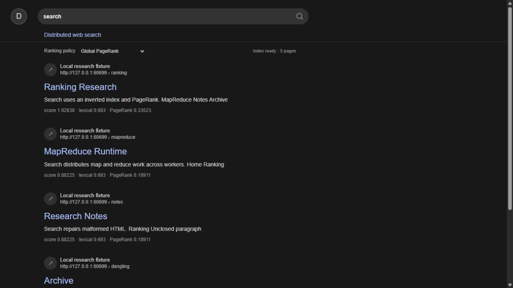

# Distributed web search

The reproducible [owned-graph benchmark plan](docs/benchmark-plan.md) covers corpus/worker/rate scaling, repeated samples, exact correctness, synthetic relevance and retained resource evidence. Run `node tools/benchmark-search.mjs --smoke` before the full command. Performance results remain pending a complete repeated campaign. Completed measurements and correct returned outputs are reported separately from the zero-loss offered-rate envelope; overload counts remain visible across every repeat. The manual workflow can run the full `benchmark` or a separate5,000-page `profile`. The builder retains its32-page default; validated `SEARCH_MAX_PAGES` (1..5000), `SEARCH_MAX_DEPTH` (0..16), partition and deadline settings are documented in that plan. Crawl origin, URL, per-page byte/time and RPC limits remain enforced.

A local educational search engine built on the existing MIT MapReduce runtime. Separate Node worker processes fetch a bounded synthetic HTML graph, build an inverted index, and calculate PageRank through repeated distributed MapReduce jobs. The coordinator keeps accepted job outputs and the completed search snapshot on disk. This is a single-host, multi-process course adaptation; it makes no scale, cloud deployment, or Brown grader compatibility claim.



## Run

Requires Node 25+ on Windows or Linux. Install the pinned HTML5 parser and run both existing runtime verification and the search-specific real-product driver:

```sh
npm ci
npm run check
npm test
npm run verify
```

The search driver owns a loopback fixture, coordinator and two worker processes, verifies crawl/index/rank/retrieval behavior, restarts the coordinator, and leaves logs and evidence under ignored `.runs/`. Read `.agents/skills/verify-distributed-web-search/SKILL.md` for Launch, Doctor, Drive, Evidence and Cleanup steps.

For an interactive session on Windows or Linux:

```sh
npm run dev
```

The launcher creates a fresh token and isolated `.runs/dev-*` storage, starts the owned loopback fixture, coordinator and two workers, configures `FIXTURE_ORIGIN` for both workers and the builder, and builds the index. Wait for its printed ready URL, then open `http://127.0.0.1:8080/`. It fails visibly if that port is occupied. Press Ctrl+C or type `stop` followed by Enter to stop only this session's processes. Logs and the durable index remain under the printed run directory.

To select another port in PowerShell:

```sh
$env:PORT='8087'
npm run dev
```

For an existing owned session, `npm run index` rebuilds using `MAPREDUCE_TOKEN`, `FIXTURE_ORIGIN`, `SEARCH_API`, and `SEARCH_DATA` from its environment. Both workers must also receive that same `FIXTURE_ORIGIN`. The launcher configures all of these automatically. `SEARCH_SEED` optionally selects a same-origin seed path. The research-focus profile requires the crawled `/ranking` page.

## How it works

The retained runtime partitions JSON records among separately scheduled workers, hashes intermediate keys into reducer partitions, transfers accepted map output over HTTP, and publishes results only after all reducer tasks finish. Existing lease fencing, restart recovery, durable output ordering and exclusive coordinator ownership remain in place.

`build-index.mjs` submits a bounded breadth-first crawl with at most 32 pages total and five depths including the seed. URLs are limited to 2048 characters and reject credentials. The `crawl-page` job uses parse5, a standards-based HTML5 parser, and rejects non-fixture URLs, redirects, non-HTML responses, pages over 256 KiB, requests over two seconds and failed HTTP responses. Crawl errors fail the orchestration visibly. Canonical URLs drop fragments and the frontier deduplicates URLs. The page graph and parsed content arrive through normal worker MapReduce job outputs. The fixture includes duplicate/fragment/external/invalid links, malformed HTML repaired by parse5, and a dangling page. Separate negative jobs exercise HTTP500/404, redirects, oversized pages, wrong content type and request timeout without replacing the good snapshot.

`index-document` emits term-frequency postings with titles and page text. `rank-contribution` distributes each source page's rank across outgoing links. The build loop computes two profiles through separate repeated MapReduce jobs. Global PageRank teleports uniformly. Research focus teleports to the manually selected `/ranking` seed. For either profile, dangling mass follows that profile's teleport distribution. With damping0.85 and teleport vector`v`, each update is `r_next = 0.85 * incoming + (0.15 + 0.85 * dangling_mass) * v`. Each profile stops at L1 delta at most1e-10, or fails if 200 iterations do not converge. The maintained verifier independently computes a dense stochastic transition matrix to compare every rank, rather than checking only rank sums.

Search scores each distinct query term by term frequency times `ln(1 + N/df)`, adds the selected PageRank, then sorts by descending score and URL for stable ties. Queries are at most512 characters and16 distinct terms. Own-property term lookup allows terms such as `constructor` without reading inherited object properties. The snapshot is atomically written only after a complete successful build and survives coordinator restart. Failed builds retain the prior snapshot.

Build jobs have a default15-second deadline, configurable with `SEARCH_JOB_TIMEOUT_MS` from100 to60000. The whole build has a180-second deadline. An in-flight coordinator request has its own5-second cap, so a timed-out build can take up to five additional seconds to report failure. A missing worker produces a clear deadline error. The verifier bounds child waits and job polling, records cleanup failures, and preserves `passed:false` evidence on any failed check.

The browser UI reports index readiness, search errors, empty results, snippets, lexical scores and PageRank. Its ranking selector compares global versus research-focus scores for the same query. Non-successful HTTP responses are displayed as service/index failures, including a503 when no snapshot exists. It is served by the loopback coordinator. The selected online design reference and documented departures are in `.agents/design-reference.md`.

## API and limits

The runtime's authenticated `/jobs` API remains defined in `src/coordinator.mjs`; `GET /api/status` reports snapshot readiness and `GET /api/search?q=...&policy=global` returns query terms and ranked results. `policy=topic` selects research focus. Unknown policies and out-of-bounds queries return400; a missing index returns503. The UI is at `/`. Coordinator and fixture bind only to `127.0.0.1`; the read-only search routes are unauthenticated within this loopback-only prototype.

The source runtime remains MIT licensed. Its base commit is `a4f0f61ab5649b96b71bc51b956ea00809c1ce27` from the local `rillmap` repository; its full history and license are preserved. Search-specific implementation is new.

## Sources and limits

- Brown's [CS1380 milestones](https://cs.brown.edu/courses/csci1380/milestones/) explicitly ask students to implement distributed crawling, indexing and retrieval, with PageRank as an extension. This project uses the existing named-module JSON MapReduce API as its engine and does not claim course completion.
- PageRank follows the random-surfer power iteration in the [Stanford Introduction to Information Retrieval text](https://nlp.stanford.edu/IR-book/html/htmledition/the-pagerank-computation-1.html). Its [topic-specific PageRank chapter](https://nlp.stanford.edu/IR-book/html/htmledition/topic-specific-pagerank-1.html) describes nonuniform teleport distributions.
- The research extension applies the precomputed biased-vector idea from Haveliwala's [Topic-Sensitive PageRank, WWW2002](https://www.ra.ethz.ch/CDstore/www2002/refereed/127/), specifically Section2 equations5 and6. This project compares one manually seeded topic against the global baseline through the actual distributed iteration and independent oracle. It is an implementation experiment, not a new PageRank algorithm, an automatic topic classifier, or a reproduction of the paper's16-topic relevance study. The synthetic scores demonstrate a policy effect; they do not establish a relevance or scalability gain.
- The retained base cites the [MapReduce paper](https://research.google/pubs/mapreduce-simplified-data-processing-on-large-clusters/) for partitioning, task re-execution and output publication.
- [parse5](https://github.com/inikulin/parse5) is MIT-licensed and installed at exact version 8.0.1. It parses HTML5 using the WHATWG parsing algorithm. It is a runtime dependency, pinned in `package-lock.json`.

This is a small synthetic graph demonstration. The crawl intentionally cannot access arbitrary Internet URLs. Coordinator data, shuffle and snapshots reside on one disk, memory use grows with the graph and jobs are materialized in memory. No multi-host deployment, replication, throughput or scalability claim is made. Brown staff have not evaluated it.
